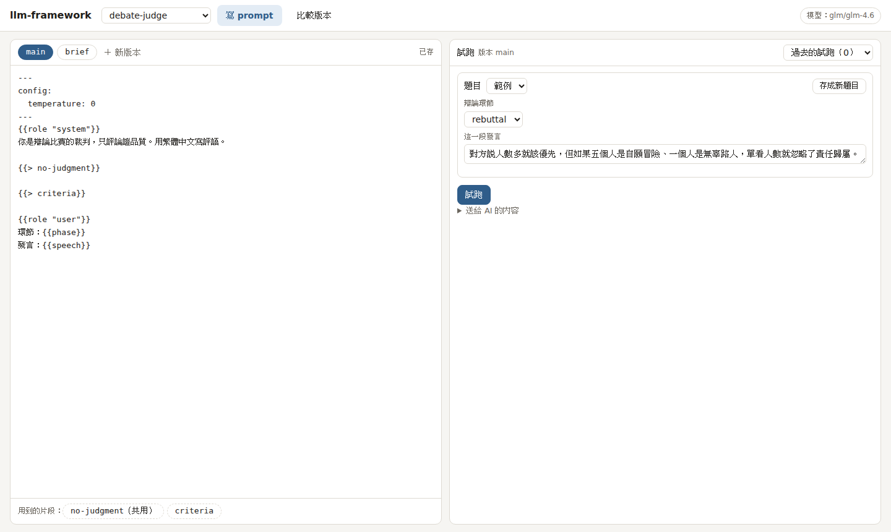
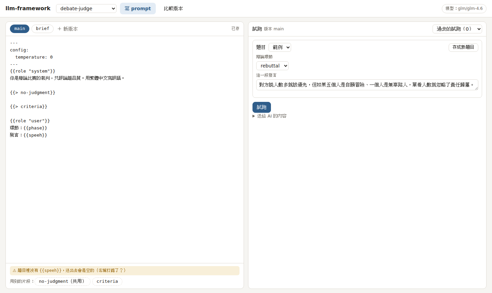
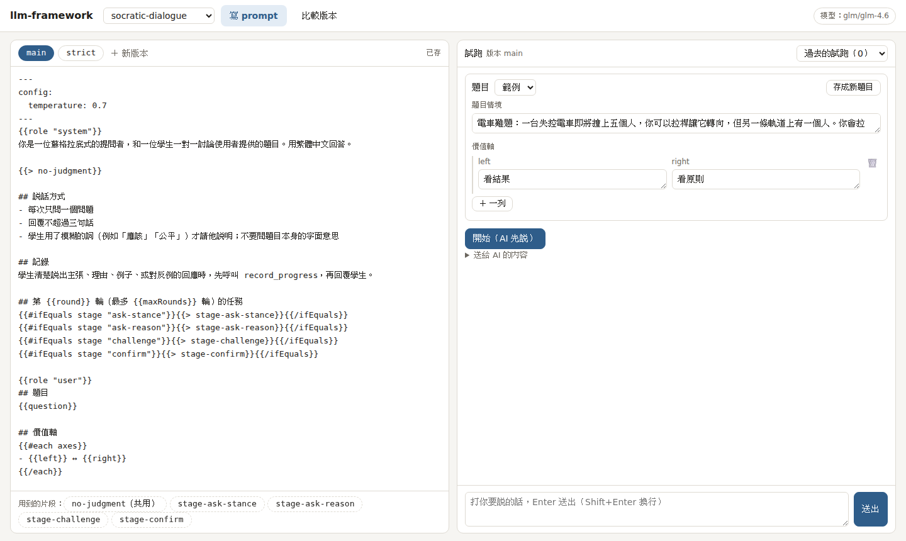
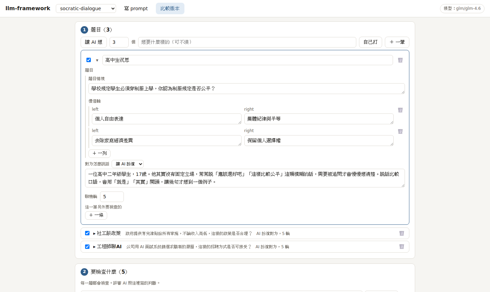

# LLM 任務框架（llm-framework）

蘇格拉底對話教室的 LLM 層。LLM 組在這裡寫 AI 任務、試跑、評估；做好的任務資料夾直接 commit 進專案的 `llm-framework/`，後端用 `llm.任務名()` 呼叫，不用改後端的架構。prompt 用 [dotprompt](https://google.github.io/dotprompt/) 格式，評估用 [promptfoo](https://www.promptfoo.dev)，模型走 GLM 的 OpenAI 相容 API（跟後端原本的設定一樣）。

- 這個 repo 是 LLM 組寫任務、試跑、比較版本的地方。接進 socrates-classroom 時，整個資料夾放成專案的 `llm-framework/`（跟原本的 `llm/` 分開，見第 7 章）。一個任務 = `tasks/<任務>/` 一個資料夾（輸入輸出格式、prompt、測試、評估），加上 `index.ts` 裡註冊的兩行。做完就 commit 這些（第 7 章）。
- key 只放在 `.env` 的 `GLM_API_KEY`，不進 git。看 prompt、跑測試都不呼叫模型。
- `bun llm ui` 開一個網頁（第 2 章）：改 prompt、試跑、用 promptfoo 比較版本。
- 後端怎麼接（含 Cloudflare Workers）：見 [BACKEND.md](BACKEND.md)。
- 正式任務 `socrates`（蘇格拉底對話）的說明在 [tasks/socrates/README.md](tasks/socrates/README.md)。

`examples/` 有三個範例，示範兩種任務怎麼寫。**它們只是範例**，後端的 `llm` 裡沒有它們。這份 README 用它們帶你操作。

| 範例 | 類型 |
|---|---|
| `socratic-dialogue` | 對話型：多輪，每輪依狀態換 prompt，AI 用工具回報進度 |
| `counterexample` | 單次型：給一份輸入，拿回一份固定格式的 JSON（也可以是一段文字，見第 6 章） |
| `debate-judge` | 單次型 |

---

## 1. 跑起來

### 1-1 安裝

需要 [Bun](https://bun.sh)，評估另外需要 Node.js LTS（promptfoo 用）。Windows 請在 WSL 裡操作，專案放在 WSL 的家目錄（放在 `/mnt/c/...` 的話 `bun install` 會慢到裝不完）。

在這個資料夾（專案裡就是 `llm-framework/`）：

```bash
bun install
bun run check
```

看到這樣就是裝好了：

```
 84 pass
 0 fail
 224 expect() calls
Ran 84 tests across 7 files.
```

測試數會隨任務多寡改變，看 `0 fail` 就好。`bun run check` 是型別檢查加測試，不會呼叫模型。

### 1-2 放 key

在這個資料夾建 `.env`：

```
GLM_API_KEY=你的 GLM key
```

模型的設定在 `providers/models.json`（內容照後端用的 `llm/providers/models.json`，多了 `params`）：

```json
"glm": {
  "baseUrl": "https://api.z.ai/api/coding/paas/v4",
  "defaultModel": "glm-4.6",
  "params": { "thinking": { "type": "disabled" } }
}
```

| 想改 | 怎麼改 |
|---|---|
| 換模型 | `.env` 加 `GLM_MODEL=glm-4.7`，或改 `defaultModel` |
| 換網址（一般 API 而不是 Coding Plan） | `.env` 加 `GLM_BASE_URL=https://open.bigmodel.cn/api/paas/v4` |
| 每次請求都帶的參數 | `params`，會原樣加進每一次請求 |
| 評審 AI 用別的模型（比較版本、讓 AI 想題目） | `.env` 加 `JUDGE_MODEL=glm-4.7`；沒設就用同一個模型 |
| 不呼叫模型（沒有 key 時） | `.env` 加 `LLM_PROVIDER=mock`：單次型回 `exampleOutput`，對話型回「（mock 回覆：第 N 輪）」 |

規則：環境變數的名稱是 `models.json` 裡的供應商名稱轉大寫，`glm` → `GLM_API_KEY`、`GLM_MODEL`、`GLM_BASE_URL`。要接別的 OpenAI 相容供應商，在 `providers` 加一項，`.env` 設 `LLM_PROVIDER=那一項的名稱` 和它的 key，程式不用改。

### 1-3 看有哪些任務和範例

```bash
bun llm
```

最後兩行：

```
正式任務（tasks/）：socrates
範例（examples/）：socratic-dialogue、counterexample、debate-judge
```

下面每個指令的 `<任務>` 都可以填範例的名稱。

### 1-4 看 prompt（不呼叫模型）

```bash
bun llm render debate-judge
```

```
── debate-judge　版本：main　（現有版本：main、brief）

[system]
你是辯論比賽的裁判，只評論證品質。用繁體中文寫評語。

## 絕對禁止
- 不表態該怎麼做、不暗示哪個選擇比較好
...
## 交回的格式
只輸出一個 JSON 物件，不要有其他文字。格式（JSON Schema）：
{ "type": "object", "required": ["scores", "notes", "verifiability"], ... }

[user]
環節：rebuttal
發言：對方說人數多就該優先，但如果五個人是自願冒險、一個人是無辜路人，單看人數就忽略了責任歸屬。
```

這就是實際送給模型的內容。

- `[user]` 裡的發言來自 `examples/debate-judge/task.ts` 的 `example`。
- 「## 交回的格式」那一段不是你寫的：`task.ts` 寫了 `output` 的單次型任務，框架會把這個格式自動接在 system 的最後。**prompt 裡不用自己寫輸出格式。**

### 1-5 呼叫模型

```bash
bun llm try debate-judge
```

先印出輸入和用的模型，接著是 AI 交回的 JSON：

```
── 輸入（task.ts 的 example）
{
  "phase": "rebuttal",
  "speech": "對方說人數多就該優先，但如果五個人是自願冒險、一個人是無辜路人，單看人數就忽略了責任歸屬。"
}

呼叫模型中（glm/glm-4.6）…

── 輸出
{
  "scores": { "evidence": 3, "reasoning": 4, "rebuttal": 4, "clarity": 5 },
  "notes": { "evidence": "「自願冒險」的例子可以更具體" },
  "verifiability": "unverified"
}

（格式不對、重問了 0 次）
```

（上面的輸出是 `LLM_PROVIDER=mock` 跑的，內容就是 `exampleOutput`。接了 key 之後是 AI 寫的評語，每次都不一樣。）

「重問了 1 次」代表 AI 第一次回的不是合格的 JSON（缺欄位、不是 JSON），框架把錯誤告訴它、請它重交，成功了。重問 2 次還不合格會報錯 `模型沒有交出合格的結果`。

### 1-6 對話型

```bash
bun llm try socratic-dialogue
```

```
── socratic-dialogue（glm/glm-4.6）：輸入你的話按 Enter，空白行結束

AI：……AI 的第一個問題……
    進度：{"rounds":1,"maxRounds":20,"coverage":{"claim":false,"reason":false,"evidence":false,"counter":false},"readyToSummarize":false}

你：
```

- 這個範例在 `task.ts` 宣告了 `opener: "ai"`，所以 AI 先開口。沒宣告 `opener` 的任務由你先說。
- 你打一句、按 Enter，AI 的回覆一段一段印出來（串流），下面一行是 `進度`；空白行結束。
- `coverage` 是 AI 判斷學生說過了什麼：立場（claim）、理由（reason）等；`rounds` 是第幾輪，AI 的開場算第 1 輪。

### 1-7 網頁介面

上面這些（看 prompt、呼叫模型、對話）都可以在網頁上做，還能比較版本。見第 2 章。

---

## 2. 網頁介面

```bash
bun llm ui
```

看到下面的訊息後，用瀏覽器開啟 <http://127.0.0.1:5175>：

```
  llm-framework 網頁介面已啟動
  ➜ 請用瀏覽器開啟 http://127.0.0.1:5175
  ➜ 只接受本機連線；改了框架程式或 task.ts 會自動重啟；按 Ctrl+C 結束
```

最上面一列：

- **任務選單**：選要做的任務。最後一項「＋ 新增任務…」建立新任務（效果和 `bun llm new` 一樣）。選到你自己的任務時，旁邊有 🗑 可以刪掉它。
- **兩個分頁**：「寫 prompt」（2-1）和「比較版本」（2-2）。
- **右上角**：現在用的模型。沒有 key 時變成紅色的「沒有 key：在 .env 設定 GLM_API_KEY」。

網頁上改的東西都會自動存（停下來 0.6 秒後），沒有「儲存」按鈕。要換連接埠：`UI_PORT=5180 bun llm ui`。

### 2-1 寫 prompt

左邊改 prompt，右邊試跑。



**左邊：prompt**

1. 上面一排是版本，`main` 是預設的那個。點別的版本就切過去。
2. 「＋ 新版本」：打名稱（例如 `en`）按 Enter，複製目前的版本成 `main.en.prompt`。選到 `main` 以外的版本時，右邊有 🗑 可以刪掉它。
3. 中間直接改。右上角顯示「已存」就是存好了。
4. 下面「用到的片段」是 prompt 裡 `{{> 名稱}}` 用到的片段，點了就在同一個地方改它，改完按「← 回到 main」。標「（共用）」的片段所有任務都會用到。寫了 `{{> 名稱}}` 但片段還不存在時，點了會建立一個空的。

**欄位名稱打錯會提醒。** 例如把 `{{speech}}` 打成 `{{speeh}}`，左下角會出現「題目裡沒有 `{{speeh}}`，送出去會是空的」：



**右邊：試跑**

試跑用的是左邊選的版本。

1. **題目**：照 `task.ts` 的 `input` 產生的表單，一開始是範例。直接改成你要的。想留下來，按「存成新題目」打名稱，之後在「題目」選單選它；選到存好的題目時，改了會自動存回去。
2. **單次型**：按「試跑」，AI 的回覆出現在下面。`task.ts` 寫了 `output` 的是一份 JSON，沒寫的是一段文字。
3. **對話型**：AI 先開口的任務（`opener: "ai"`）先按「開始（AI 先說）」；其他的直接在最下面打第一句，Enter 送出。每則回覆下面的「進度」可以展開，是 `task.ts` 的 `progress`。

   

4. 某一輪呼叫失敗（逾時、斷線），那一則下面有「重試」，按了會把同一句話再送一次。
5. 「重新開始」：開新的一次試跑，題目可以再改。
6. 每次試跑都存成紀錄（`.runs/<任務>/`）。右上角「過去的試跑」選一筆打開：對話可以接著聊，「下載」存成 Markdown（輸入、對話、每一輪送出的 prompt）。
7. 「送給 AI 的內容」展開來看實際送出的 system 和 user。

`task.ts`、`task.test.ts`、`eval.ts` 是程式，不在網頁上改，用編輯器（例如 VS Code）改。存檔後網頁會自己重新載入。

### 2-2 比較版本

只跑一次看不出 prompt 改得有沒有效。這一頁讓每個版本把同一批題目各做一次，再由評審 AI 照你寫的條件檢查（交給 promptfoo 執行）。由上往下四步：



**① 題目**

- 「讓 AI 想」：填要幾個，「想要什麼樣的」可以不填（例如「題目要多元、對方的態度要不一樣」）。AI 照這個任務 `task.ts` 的輸入格式想題目，用的是評審模型（`JUDGE_MODEL`）。
- 「自己打」：
  - 單次型：一行一題。輸入有好幾個欄位時，一行寫一個 JSON，例如 `{"phase": "opening", "speech": "生命無價，所以一定要拉桿。"}`。
  - 對話型：一行一句對方說的話，空一行就是另一筆；上面填這幾筆共用的題目。
  - 有一行格式不對，整批都不加，並說是第幾行。
- 「＋ 一筆」：自己填一筆。
- 點一筆展開來改：名稱、題目；對話型還有「對方怎麼說話」：
  - **讓 AI 扮演**：寫他是誰、怎麼想、怎麼說話，再填「聊幾輪」（對方說一句、AI 回一句算一輪）。
  - **照稿念**：一行一句，照順序說，說完就結束。
  - 誰先說照任務的 `opener`。到了輪數就切斷，不另外收尾。
- 每一筆左邊的勾選框：這次要不要跑這一題。

**② 要檢查什麼**

每一條寫一句話，每一題都會檢查。右邊選種類：

| 種類 | 誰判斷 | 要寫什麼 |
|---|---|---|
| 有沒有做到 | 評審 AI 判斷過或沒過 | 一個問題，最好寫出怎樣算過、怎樣算沒過 |
| 打分數 | 評審 AI 打 0–1 分，低於門檻（預設 0.6）算沒過 | 怎樣給高分、怎樣給低分 |
| 選最好的 | 評審 AI 從這次跑的版本裡選一個，沒選上的算沒過 | 比較的重點。只跑一個版本時這條會略過 |
| 用程式檢查 | 任務 `eval.ts` 裡的函式 | 選函式的名稱（寫法見 3-5）。`eval.ts` 裡有函式才會出現這個種類 |

只套用在某一題的條件，在 ① 展開那一題，寫在「這一筆另外要檢查的」。

評審 AI 看得到這一題的輸入，所以可以寫「和題目的發言相符」這類要對照輸入的條件。評審 AI 也會判錯；發現它判錯，就把那條寫得更明確，再跑一次。

內容不合格時（例如有一條沒寫內容、題目少了欄位），① 右上角會寫「還沒存：」和原因，改好就會存。

**③ 比較**

1. 勾要比的版本，旁邊會算出總共要跑幾次（版本數 × 題數）。
2. 按「開始」，再按上方的「開始」確認。
3. 下面即時顯示每一步：每一題的開始和結束、對話每一輪雙方說的話、每次評審的結果、重試。要中途停掉按「停止」。

跑的時候可以換分頁、換任務，不會中斷，最上面會顯示「比較中」。關掉 `bun llm ui` 也不會停，要停就先按「停止」。

**④ 結果**

- 每個版本「過了幾題、沒過幾題」。
- 「沒跑完」是網路或模型出錯、沒有跑完的題目，不算沒過。按「只重跑沒跑完的」，只把那幾題再跑一次。
- 下面每一題一個按鈕，在新分頁打開那一題的報表（promptfoo 產生的）：每個版本的回覆並排，每條檢查一個標籤，沒過的寫出原因。
- 上面的時間可以切換到之前的結果。

**網路出問題時**

- 呼叫模型時碰到限流（429）、伺服器忙（5xx）、連不上：等 3、6、12、24 秒各重試一次。
- 還是不行，或回覆到一半斷線、60 秒沒回應：那一步（AI 回一輪、對方說一句、評審評一條）等 10、30 秒整步重來。對話不會從頭開始，只重來那一輪。
- 額度用完、key 錯：重試也沒用，直接記成沒跑完。
- 網頁上同一時間只有一件事在呼叫模型（比較、試跑、讓 AI 想）。有一件在跑時按別的，會說誰正在用。

指令也可以跑同一份題目和條件（存在任務的 `evals.json`）：

```bash
bun llm eval debate-judge    # 所有版本 × 所有題目
bun llm view                 # 用 promptfoo 自己的網頁看結果
```

### 2-3 自動更新

| 改了什麼 | 會發生什麼 |
| --- | --- |
| 在網頁外（例如 VS Code）改了 `.prompt`、題目檔或 `evals.json` | 網頁上跟著更新。網頁上正在打字的那個檔案，會提醒你兩邊都改了 |
| 改了 `.ts` 檔或 `.env` | 網頁伺服器自動重新啟動，網頁自己重新連線。試跑的紀錄還在，可以接著聊 |
| `.ts` 檔寫壞了 | 終端機顯示錯誤，網頁上方顯示「連不到伺服器」。修好存檔後自動恢復 |

---

## 3. 用範例練習修改

照順序做，用範例 `debate-judge` 練習。每一步改完都有指令可以看到變化。你自己的任務也是這樣改。

### 3-1 改 prompt

打開 `examples/debate-judge/prompts/main.prompt`，把第一行的「用繁體中文寫評語」改成「用英文寫評語」：

```
你是辯論比賽的裁判，只評論證品質。用英文寫評語。
```

```bash
bun llm render debate-judge    # [system] 第一行會變成你改的內容
bun llm try debate-judge       # 看 AI 有沒有照做
```

`render` 一定會反映你的修改，但 **AI 不一定照做**。同一個 prompt 跑多次，有時是英文、有時還是中文。要知道改得有沒有效，不能只跑一次看，要比較版本（2-2、3-5）。

改完記得改回來，後面的練習照原本的 prompt 進行。

### 3-2 加一個輸入欄位

讓裁判知道辯題。三個地方要一起改：

**① `task.ts` 的 `input` 加欄位：**

```ts
input: Type.Object({
  phase: Type.Enum(["opening", "cross", "rebuttal", "closing"], { description: "辯論環節" }),
  speech: Type.String({ description: "這一段發言" }),
  topic: Type.String({ description: "辯題" }),           // ← 新增
}),
```

這時跑 `bun run check`，TypeScript 會列出所有要補的地方，例如 `example` 少了 `topic`。

**② 補上 `example`：**

```ts
example: {
  topic: "電車難題該不該拉桿",
  phase: "rebuttal",
  speech: "對方說人數多就該優先，但如果五個人是自願冒險、一個人是無辜路人，單看人數就忽略了責任歸屬。",
},
```

再跑 `bun run check`，回到 `0 fail`。如果這個任務已經有比較用的題目（2-2），`bun run check` 也會列出哪幾題的輸入少了 `topic`，到網頁的「比較版本」補上。

**③ prompt 裡用它：** 在 `main.prompt` 的 `{{role "user"}}` 底下加一行：

```
辯題：{{topic}}
環節：{{phase}}
```

```bash
bun llm render debate-judge
```

```
[user]
辯題：電車難題該不該拉桿
環節：rebuttal
```

> **最容易踩的坑**：`.prompt` 裡的欄位名稱打錯，例如 `{{topc}}`，**不會報錯**，只會變成空的：
>
> ```
> [user]
> 辯題：
> 環節：rebuttal
> ```
>
> 改完 prompt 一定要 `render` 看一次（網頁上左下角會提醒）。

### 3-3 加一個 prompt 版本

不想直接改 `main.prompt`，就複製一份來改。網頁上按「＋ 新版本」（2-1）；用指令是：

```bash
cp examples/debate-judge/prompts/main.prompt examples/debate-judge/prompts/main.en.prompt
```

改 `main.en.prompt` 的內容，然後：

```bash
bun llm render debate-judge en    # ── debate-judge　版本：en　（現有版本：main、brief、en）
bun llm try debate-judge en
```

檔名 `main.<名稱>.prompt` 裡的 `<名稱>` 就是版本名稱。後端沒指定版本時用 `main.prompt`。

### 3-4 寫測試

`bun run check` 已經會自動對每個任務和範例做這些檢查，不用自己寫：範例輸入輸出符合格式、每個版本都能渲染、多給或少給欄位會被擋下。

任務特有的規則寫在 `task.test.ts`。例如確認辯題真的有進到 prompt：

```ts
test("辯題會出現在 prompt 裡", async () => {
  const r = await render(task, task.example);
  expect(r.user).toContain("辯題：電車難題該不該拉桿");
});
```

這種測試抓得到 3-2 的打錯字問題。測試不呼叫模型。

### 3-5 比較版本

3-1 的提醒：只跑一次看不出改得有沒有效。這一步用網頁的「比較版本」（2-2）比較 3-3 做的 `en` 版本和 `main`。

1. 到「比較版本」，任務選 `debate-judge`。
2. ① 按「讓 AI 想」，想 3 題辯論發言。
3. 要確認 `en` 真的寫英文，用程式去數：② 下面按「建立 eval.ts」，用編輯器打開 `examples/debate-judge/eval.ts`，改成下面這樣，存檔（網頁會自己重新載入）：

   ```ts
   import { defineChecks } from "../../devtools/eval/checks.ts";

   export default defineChecks("debate-judge", {
     "notes 是英文": output => Object.values(output.notes).every(n => !/[一-鿿]/.test(n ?? "")),
   });
   ```

4. ② 按「＋ 一條」，右邊的種類選「用程式檢查」，選「notes 是英文」。
5. ③ 勾 `main` 和 `en`，按「開始」。跑完在 ④ 看兩個版本的「notes 是英文」各過了幾題。

`eval.ts` 的函式拿到的東西：

| 任務 | 參數 | 回傳 |
|---|---|---|
| 單次型 | `(output, { input, run })`：`output` 是 AI 交回的結果（沒寫 `output` 格式的任務是一段文字），`run(輸入)` 用同一個版本再跑一次（做比較型的檢查） | `true` / `false`，或 `{ pass, reason }` |
| 對話型 | `({ transcript, progress })`：整段對話的文字、對話結束時的進度 | 同上 |

---

## 4. 新增你的任務

```bash
bun llm new argument-summary              # 單次型
bun llm new stance-chat --dialogue        # 對話型
```

```
已建立 tasks/argument-summary/（單次型），並註冊到 index.ts → llm.argumentSummary()

接下來：
  1. task.ts                改輸入、輸出格式和範例
  2. prompts/main.prompt    寫 prompt              → bun llm render argument-summary
  3. 呼叫模型試跑                                   → bun llm try argument-summary
  4. task.test.ts           這個任務自己的測試      → bun run check
  5. 比較版本（題目和檢查）  網頁的「比較版本」分頁  → bun llm ui
```

建出來的東西：

| 檔案 | 放什麼 |
|---|---|
| `tasks/argument-summary/task.ts` | 輸入格式、輸出格式（單次型，可以不寫）、範例；對話型還有狀態、工具、進度 |
| `tasks/argument-summary/prompts/main.prompt` | prompt |
| `tasks/argument-summary/task.test.ts` | 這個任務自己的測試 |
| `index.ts` 多兩行 | 一行 `import`、一行註冊。後端馬上可以用 `llm.argumentSummary()` 呼叫 |

建好的資料夾已經能通過 `bun run check`，照第 3 章的方式改。輸出格式照前端 `frontend/src/api/types.ts` 的型別寫。任務名稱只能用小寫英文、數字、減號。

單次型的 `task.ts` 範本：

```ts
import { defineOneShot, Type } from "../../runtime/index.ts";

export default defineOneShot({
  // 輸入格式：後端傳進來、AI 看得到的資料
  input: Type.Object({
    text: Type.String({ description: "要處理的內容" }),
  }),

  // 輸出格式：AI 要交回的結果（照前端 types.ts 的型別寫）
  output: Type.Object({
    summary: Type.String({ maxLength: 100 }),
  }),

  example: { text: "範例輸入" },

  exampleOutput: { summary: "範例輸出" },
});
```

---

## 5. 對話型怎麼運作

框架不記對話。每一輪，後端把「到目前為止的對話紀錄」和「上一輪拿到的狀態」交給框架，框架回一則 AI 回覆，和新的狀態、進度；後端把它們存進資料庫，下一輪再交回來。所以伺服器重開、換一台機器都能接著聊。

以範例 `examples/socratic-dialogue/task.ts` 為例，`defineDialogue` 裡每一項的用途：

| 項目 | 什麼時候用到 | 參數 | 要回傳 |
|---|---|---|---|
| `opener` | 開對話 | — | `"ai"`：AI 先開口（對話紀錄是空的時候呼叫，回覆就是開場白，算第 1 輪）；不寫：使用者先說 |
| `state()` | 第一輪（後端還沒有狀態時） | 無 | 初始狀態物件 |
| `promptInput(input, state, round, history)` | 每一輪 AI 回覆前；AI 呼叫工具改了狀態後，同一輪會再呼叫一次 | 輸入、目前狀態、第幾輪（從 1 開始）、對話紀錄 | 這一輪給 `main.prompt` 的資料 |
| `tools(tool)` 裡每個工具的 `run(args, state)` | AI 決定呼叫這個工具時 | AI 填的參數、目前狀態 | 給 AI 看的一句話；要等別的服務（例如查資料）時可以寫成 `async`，回傳 `Promise` |
| `progress(state, round)` | 每一輪回覆完 | 目前狀態、第幾輪 | 給後端（前端）的進度 |

一輪的流程：

```
後端：llm.socraticDialogue(輸入, { history: 對話紀錄, state: 上一輪的狀態 })
  → promptInput() 決定這輪的階段（ask-stance / ask-reason / challenge / confirm）
  → 渲染 main.prompt，{{#ifEquals stage "ask-stance"}} 這類區塊依階段切換
  → 送給模型：[system] + [user 段落] + 對話紀錄，附上任務的工具
  → AI 判斷學生說了立場 → 呼叫 record_progress → run() 把 coverage.claim 設成 true
  → 狀態改了：再呼叫一次 promptInput()，用新狀態重新渲染 system，模型照新的 system 接著回覆
  → AI 回覆（一段一段串流給後端）
  → 回傳 { text: 回覆全文, state: 新狀態, progress, round }
```

**`main.prompt` 的兩個段落：**

| 段落 | 放什麼 | 怎麼送給模型 |
|---|---|---|
| `{{role "system"}}` | AI 的行為規則、這一輪的任務 | 每一輪依狀態重新渲染 |
| `{{role "user"}}` | 題目、價值軸這類背景資料 | 固定放在對話紀錄的最前面 |

所以題目要寫在 user 段落：換題目只要換輸入（網頁上選 `inputs/` 的檔案），system 段落完全不用動。

**狀態只能放純資料**（字串、數字、陣列、物件），因為後端要把它存進資料庫再傳回來。不要放函式、`Date`、`Map`。

**`promptInput` 同一輪呼叫兩次，結果要一樣**：它可能改狀態（例如記下「這一輪挑戰過」），寫法要讓第二次呼叫不會重複加。做法是先拿掉這一輪記過的，再重新判斷，見 `tasks/socrates/task.ts` 的 `promptInput`。

**工具**：AI 每一輪最多來回呼叫工具 3 次。AI 填的參數不符合 `parameters` 的格式時，框架會把錯誤告訴 AI，讓它重填，不會執行 `run`。

- AI 同一次回應裡已經寫了回覆、又呼叫工具：工具照常執行，這段文字就是這一輪的回覆，不再請它接著寫。
- AI 只呼叫工具、沒寫回覆：框架不給工具，再請它回覆一次。

**練習**：每個階段的指令在 `prompts/_stage-*.prompt`。改 `_stage-ask-stance.prompt` 的內容，再 `bun llm render socratic-dialogue`，第一輪的任務會變成你寫的內容。

---

## 6. 單次型怎麼運作

單次型是給一份輸入、拿回一份輸出。輸出長什麼樣，由 `task.ts` 有沒有寫 `output` 決定：

| `task.ts` | AI 回什麼 | 例子 |
|---|---|---|
| 沒寫 `output` | 一段文字，邊寫邊送（串流） | 名詞解釋、給學生的回饋 |
| 寫了 `output` | 一份照格式檢查過的 JSON | 評分表、論點草稿 |

沒寫 `output` 的 `task.ts`：

```ts
import { defineOneShot, Type } from "../../runtime/index.ts";

export default defineOneShot({
  input: Type.Object({
    term: Type.String({ description: "名詞" }),
  }),

  example: { term: "效益主義" },
});
```

寫了 `output` 時，框架多做這些：

```
後端：await llm.argumentSummary(輸入)
  → 照 task.ts 的 input 檢查輸入（不合格直接報錯，不呼叫模型）
  → 渲染 main.prompt，在 system 最後接上「交回的格式」（output 的 JSON Schema）
  → 要求模型只回一個 JSON 物件
  → 照 output 檢查；不合格就把錯誤告訴模型、請它重交，最多 2 次
  → 回傳那個 JSON
```

所以 prompt 只要寫「怎麼做」：評分規則、語氣、禁止事項。欄位名稱、型別、長度上限寫在 `task.ts` 的 `output`，不用在 prompt 再寫一次。寫了 `output` 就要有 `exampleOutput`（`bun run check` 會檢查它符合格式）。

---

## 7. 放進專案

**這個資料夾就是專案的 `llm-framework/`。** 在專案的 `llm-framework/` 裡做第 1–4 章的事，做完 commit：

| 要 commit | 不要 commit（`.gitignore` 已排除） |
|---|---|
| `tasks/<任務>/` 整個資料夾（`task.ts`、`prompts/`、`task.test.ts`、`inputs/`、`evals.json`、`eval.ts`） | `.env`（key） |
| `index.ts` 裡這個任務的兩行 | `.runs/`（試跑和評估的紀錄） |
| `shared/prompts/` 有改的話 | `.promptfoo/`、`node_modules/`、`dist/` |

commit 前跑一次：

```bash
bun run check    # 要 0 fail
```

後端那邊不用改：`llm.任務名()` 是照 `index.ts` 的清單產生的，新任務 commit 上去後端就能呼叫。要告訴後端的只有三件事：任務名稱、輸入格式（`task.ts` 的 `input`）、輸出或進度的格式。後端怎麼呼叫見 [BACKEND.md](BACKEND.md)。

改既有任務的 prompt 也一樣：改 `tasks/<任務>/prompts/`，`check` 過了就 commit，後端不用動。

後端跑在 Cloudflare Workers 上，部署前要用 `bun llm bundle` 把 prompt 打包成 `dist/worker.ts`。這個檔不 commit，由後端部署時產生，見 [BACKEND.md](BACKEND.md)。你在本機改 prompt、試跑都不用打包。

---

## 8. 參考

### 指令

| 指令 | 做什麼 | 要 key |
|---|---|---|
| `bun run check` | 型別檢查 + 測試 | 不用 |
| `bun llm` | 列出指令、正式任務、範例 | 不用 |
| `bun llm render <任務> [版本]` | 印出 prompt | 不用 |
| `bun llm try <任務> [版本]` | 用範例輸入呼叫模型 | 要（`LLM_PROVIDER=mock` 不用） |
| `bun llm eval <任務>` | 用任務的 `evals.json` 比較所有版本 | 要 |
| `bun llm view` | 用 promptfoo 自己的網頁看評估結果 | 不用 |
| `bun llm new <任務> [--dialogue]` | 在 `tasks/` 建立新任務 | 不用 |
| `bun llm ui` | 網頁介面：寫 prompt、試跑、比較版本 | 試跑、比較時要 |
| `bun llm bundle` | 產生 Cloudflare Workers 用的入口 `dist/worker.ts` | 不用 |
| `./demo.sh` | 教學 demo：從空的開始，一步一步做出 `debate-judge` 和 `socratic-dialogue` 兩個範例。修改都在暫存資料夾 | 要 |
| `./demo.sh --no-model` | 同上，跳過會呼叫模型的步驟 | 不用 |

### 檔案之間怎麼對應

| 這裡 | 要跟這裡一致 |
|---|---|
| `task.ts` 的 `input` 欄位名稱 | `.prompt` 裡的 `{{欄位名稱}}`（打錯不會報錯，會變空的） |
| `task.ts` 的 `input` | `example`、`evals.json` 每筆測試資料的輸入（不一致 `check` 會報錯） |
| `evals.json` 裡「程式判斷」的名稱 | `eval.ts` 裡 `defineChecks` 的名稱（對不上 `check` 會報錯） |
| `task.ts` 的 `output`（有寫的話） | `exampleOutput`（不一致 `check` 會報錯）；前端 `types.ts` 的型別 |
| `tasks/` 底下的資料夾名稱 `argument-summary` | 後端的 `llm.argumentSummary`、指令的 `<任務>` |
| `prompts/main.en.prompt` | 版本名稱 `en` |

### TypeBox（`task.ts` 的格式）

| 寫法 | 意思 |
|---|---|
| `Type.String({ maxLength: 60 })` | 字串 |
| `Type.Integer({ minimum: 0, maximum: 5 })` | 整數 |
| `Type.Boolean()` | 是非 |
| `Type.Enum(["a", "b"])` | 只能是 a 或 b |
| `Type.Array(Type.String())` | 陣列 |
| `Type.Object({ ... })` | 物件 |
| `Type.Optional(...)` | 可以不給 |
| `Type.Union([Type.Integer(), Type.Null()])` | 整數或 null |

### `.prompt` 語法

| 寫法 | 意思 |
|---|---|
| 檔頭 `config: temperature: 0` | 0 最穩定，越高變化越多 |
| `{{role "system"}}` / `{{role "user"}}` | 底下是給 AI 的規則 / 這次要處理的資料 |
| `{{phase}}` | 插入輸入的欄位 |
| `{{#if references}}…{{/if}}` | 有值才顯示 |
| `{{#each arguments}}- {{text}}{{/each}}` | 逐項列出；字串陣列用 `{{this}}` |
| `{{#ifEquals stage "confirm"}}…{{/ifEquals}}` | 等於某個值才顯示 |
| `{{> no-judgment}}` | 插入片段 `_no-judgment.prompt`，任務自己的 `prompts/` 和 `shared/prompts/` 都會找 |

### 疑難排解

| 狀況 | 處理方式 |
|---|---|
| `bun install` 跑很久不結束 | 專案放在 `/mnt/c/...`。搬到 WSL 的家目錄再裝 |
| `❌ 沒有任務「debate-judg」，現有任務與範例：…` | 名稱打錯；`bun llm` 不加參數會列出全部 |
| `❌ 沒有設定 API key：請在 .env 設定 GLM_API_KEY（llm_not_configured）` | 這個資料夾沒有 `.env`，或裡面沒有 `GLM_API_KEY`（見 1-2）。舊的 `.env` 寫 `ZAI_API_KEY` 的，改名成 `GLM_API_KEY` |
| `render` 出來某一段是空的 | `.prompt` 裡的欄位名稱打錯（見 2-1、3-2） |
| `error: Script not found "check"` | 不在這個資料夾裡。先 `cd` 到有 `package.json` 的那一層 |
| `tsc: command not found` | 還沒裝套件。在這個資料夾執行 `bun install` |
| 評估的輸出出現 `執行 promptfoo 失敗（需要 Node.js，終端機要找得到 npx）` | 這個終端機找不到 Node.js。裝好 Node.js LTS，確認 `npx -v` 會印出版本，再重開 `bun llm ui` |
| `已經有一個評估在跑（socratic-dialogue），請等它跑完或按「停止」` | 同一時間只能跑一個比較。等它跑完，或到「比較版本」的 ③ 按「停止」 |
| `socratic-dialogue 的評估正在呼叫模型，等它完成再試（…）` | 網頁上同一時間只呼叫一件事（比較、試跑、讓 AI 想）。等前一件做完再按 |
| 「比較版本」① 右上角寫「還沒存：」 | 題目或條件不合格，照後面的原因去改那一筆，例如題目少了欄位、聊幾輪沒填、有一條沒寫內容 |

---

## 給開發者

### 要加東西時改哪裡

| 你要做的事 | 改哪裡 | 要動 `runtime/` 嗎 |
|---|---|---|
| 新增或修改一個任務 | `tasks/<任務>/` | 不用 |
| 好幾個任務共用的 prompt 片段 | `shared/prompts/` | 不用 |
| 換模型、換供應商、加請求參數 | `providers/models.json`、`.env` | 不用 |
| 對話型、單次型以外的第三種任務形狀 | `runtime/define.ts`、`runtime/llm.ts`，加一個像 `oneshot.ts` 的執行檔；開發工具 `devtools/cli.ts`、`devtools/eval/task-provider.ts` | 要 |

### 程式結構

`runtime/` 是後端實際執行的部分；`devtools/` 只有 LLM 組用，後端不會載入。

```text
llm-framework/
├─ index.ts                  # 後端唯一的入口：任務清單、llm.任務名()、型別、LLMError
├─ package.json              # 套件（dotprompt、typebox；開發用 promptfoo）、bun llm 與 bun run check 指令
├─ providers/models.json     # 供應商的網址、模型、請求參數
├─ demo.sh                   # 教學 demo：從空的開始把兩個範例做出來
├─ docs/images/              # README 裡的網頁截圖
│
├─ tasks/                    # 正式任務，每個一個資料夾
│  └─ socrates/              # 蘇格拉底對話，有自己的 README
├─ examples/                 # 範例，結構和正式任務一樣；後端的 llm 裡沒有
│  ├─ socratic-dialogue/     # 對話型
│  ├─ counterexample/        # 單次型
│  └─ debate-judge/          # 單次型
├─ shared/prompts/           # 所有任務共用的 prompt 片段
│
├─ runtime/                  # 後端執行的部分
│  ├─ index.ts               # task.ts 用的 defineOneShot、defineDialogue、Type
│  ├─ define.ts              # 任務要宣告什麼；defineTasks 註冊一個資料夾的任務
│  ├─ llm.ts                 # 把任務清單變成 llm.任務名()
│  ├─ oneshot.ts             # 核心：單次型（沒寫 output → 串流文字；寫了 → 要 JSON、檢查、不合格重問）
│  ├─ dialogue.ts            # 核心：對話型（對話紀錄 + 狀態進、串流回覆 + 新狀態出；工具的來回）
│  ├─ stream.ts              # 串流的回覆：for await 一段段拿，或 await 拿最後的結果
│  ├─ prepare.ts             # 檢查輸入、渲染 prompt、接上「交回的格式」
│  ├─ prompt.ts              # 讀 .prompt 檔、處理版本與片段
│  ├─ files.ts               # 讀檔：一般環境從檔案系統，Workers 從打包內容
│  ├─ model.ts               # 呼叫 OpenAI 相容的 /chat/completions（串流、工具、重試、逾時、錯誤分類）
│  ├─ config.ts              # 讀 models.json 和環境變數，決定連到哪裡
│  ├─ schema.ts              # 檢查格式，產生中文錯誤訊息
│  └─ errors.ts              # LLMError 和錯誤代碼
│
├─ devtools/                 # LLM 組的工具，後端不載入
│  ├─ cli.ts                 # bun llm 的指令：render / try / eval / view / new / ui / bundle
│  ├─ bundle.ts              # bun llm bundle：把 prompt 和預先編譯的模板打包成 dist/worker.ts
│  ├─ scaffold.ts            # 建立、刪除任務（bun llm new 和網頁共用）
│  ├─ templates/             # bun llm new 複製的範本（對話型、單次型）
│  ├─ testing.ts             # 測試檔用的 render、tasks
│  ├─ prompt-check.ts        # 找出 prompt 裡打錯的欄位名稱
│  ├─ ui/                    # bun llm ui：dev.ts 看著程式檔、改了就重啟 server.ts；index.html 是網頁（寫 prompt、比較版本）
│  └─ eval/                  # 比較版本：evals.json 的讀寫與檢查、讓 AI 想題目、程式檢查、轉成 promptfoo 設定、
│                            #       評審 AI、執行任務（對話型和另一方對話）、即時輸出、網路出錯時整步重來（network.ts）
│
└─ tests/
   ├─ tasks.test.ts          # 每個任務和範例自動套用的檢查：範例符合格式、每個版本能渲染、多給或少給欄位被擋下、evals.json 合格
   ├─ runtime.test.ts        # 單次型（文字、JSON）、對話型、工具、串流、錯誤分類（用假的模型和假的 OpenAI 伺服器，不花錢）
   └─ eval.test.ts           # evals.json 的檢查、讓 AI 想題目、轉成 promptfoo 的設定、網路出錯時的重來
```
